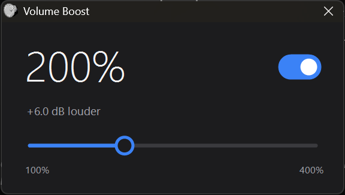
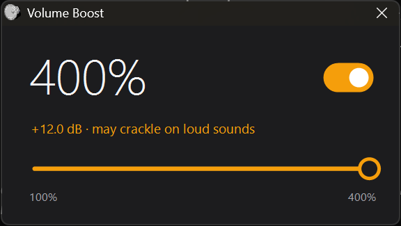

# 🔊 Volume Boost

**Make quiet Windows laptop speakers loud again.** Volume Boost is like VLC's 125%–200% volume boost — that trick where you push the volume *past* the maximum — but it works for **everything** on your PC, not just one video player: YouTube, Netflix, Spotify, Zoom calls, games, anything. Drag one slider from 100% up to **400%** (+12 dB) and your whole system gets louder.




Why you might want it:

- 💻 **Quiet laptop speakers** that are too soft even at 100%.
- 🎬 **Films and shows** with dialogue you can barely hear.
- 🎧 Works on **speakers or headphones** — whatever Windows is playing through.
- 🪶 **Tiny and quiet:** one ~32 KB tray app, 0% CPU when idle, no account, no ads, no internet connection.

It's a single tray app for Windows 10/11. Under the hood it drives [Equalizer APO](https://sourceforge.net/projects/equalizerapo/), a free, trusted audio processor, to do the actual amplifying.

> ⚠️ Big boosts can distort or, played loud for a long time, damage small speakers. The app turns **orange** above 300% as a reminder:
>
> 

## Install

1. **Install Equalizer APO.** Download it from [sourceforge.net/projects/equalizerapo](https://sourceforge.net/projects/equalizerapo/). The SourceForge page has adverts and a download countdown; the real file is the green **Download** button at the top. During setup, the Configurator asks which devices to install to: tick your **speakers**. Then restart your PC.
2. **Download `VolumeBoost.exe`** from the [Releases](../../releases) page.
3. **Put it in its own folder.** Make a folder at `C:\Program Files\VolumeBoost` and move `VolumeBoost.exe` into it. Windows will ask for permission to use that folder; click **Continue**. Keeping the app here (not in Downloads or on the Desktop) is safer and is **required** for "Start with Windows" to work.
4. Run it. Windows asks **"Do you want to allow this app to make changes?"**. Click **Yes**. Volume Boost needs admin rights to change Equalizer APO's settings, which live in `C:\Program Files`.

The first time, it starts at **200%** (twice as loud).

**"Windows protected your PC"?** Windows shows this for any new app that isn't signed with a paid certificate. The UAC prompt will also say **Publisher: Unknown** in yellow. That's expected for a free open-source app. Click **More info → Run anyway**. The full source code is in this repo. If you'd rather not trust a download, you can build the app yourself (see below).

> **Note for shared or work PCs:** if your own account isn't an administrator and you type an admin's password at the prompt, Volume Boost runs as that admin, not as you. The boost still works, but "Start with Windows" won't start it for your account. On a PC where you're the only user (a normal home laptop), this doesn't apply.

## Use

- Drag the slider, or use the mouse wheel or arrow keys. The boost applies instantly.
- The switch turns the boost on and off.
- Closing the window (or pressing Esc) keeps the boost running in the **system tray**. On Windows 11 the icon is hidden at first: click the **^** arrow next to the clock to find it. Drag it onto the taskbar to keep it visible.
- **Start with Windows:** right-click the tray icon → **Start with Windows**. It then starts quietly in the tray each time you sign in, with no "allow changes" prompt. This needs the app to be kept in `C:\Program Files\VolumeBoost` (see Install); if it's somewhere else, Volume Boost will tell you to move it there first. If you move or rename the exe later, turn this off and on again.
- Right-click the tray icon → **Exit** turns the boost off. It stays off the next time you open the app, until you switch it back on.

## ⚠️ Be careful

- Boosting past 100% can **distort** loud sounds (clipping). Played loud for long periods, it can also **damage small laptop speakers**. If the sound crackles, turn the boost down. The app turns orange above 300% as a reminder.
- **Headphones:** if you ticked your headphones in Equalizer APO too, they get the same boost. +12 dB in your ears is a lot, so turn your volume down first.
- If the app is force-closed (for example from Task Manager), the boost stays on. Open Volume Boost again and use Exit to turn it off.

## Troubleshooting

- **The slider moves but nothing gets louder.**
  1. Make sure you restarted your PC after installing Equalizer APO.
  2. Open the **Equalizer APO Configurator** (Start menu) and check that the device you're listening on is ticked.
  3. If you use different devices (speakers, headphones, HDMI), Equalizer APO only affects the ticked ones.
- **Sound crackles or distorts.** Lower the boost. Speakers have a physical limit.
- **"Couldn't apply" message.** If it says the file is **busy**, another program (such as the Equalizer APO Editor) was writing it; move the slider again. If it says to **run as administrator**, close Volume Boost and reopen it, clicking **Yes** on the "allow changes" prompt.

## How it works

Volume Boost writes one line, `Preamp: +X dB`, to its own file `VolumeBoost.txt` in Equalizer APO's config folder. It adds `Include: VolumeBoost.txt` to `config.txt`. Your other Equalizer APO settings are left alone. 200% = +6 dB, 400% = +12 dB.

## Uninstall

1. Right-click the tray icon. Turn off **Start with Windows** if it's on, then click **Exit**.
2. Delete `VolumeBoost.exe` (and the `C:\Program Files\VolumeBoost` folder) and the folder `%APPDATA%\VolumeBoost`.
3. Optional: in `C:\Program Files\EqualizerAPO\config\`, delete `VolumeBoost.txt` and remove the `Include: VolumeBoost.txt` line from `config.txt`. You'll need to open your editor as administrator. Leaving them is harmless: after you click **Exit**, the file is set back to `0 dB`, so there's no boost.

## Build it yourself

No Visual Studio needed. Windows already ships the C# compiler. Run:

```
build.bat
```

This creates `VolumeBoost.exe` next to it. Put an icon at `src\speaker.ico` if you want one.

For scripts: `VolumeBoost.exe --tray` starts hidden in the tray. `VolumeBoost.exe --startup on|off` turns Start with Windows on or off.

## License

MIT
